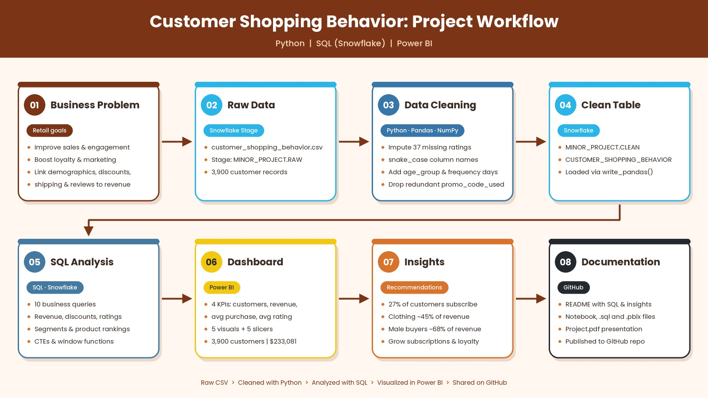

# DATA-ANALYTICS

<p align="center">
  
</p>

<h1 align="center">🛍️ Customer Shopping Behavior Analysis</h1>

<p align="center">
  <a href="https://git.io/typing-svg">
    
  </a>
</p>

<p align="center">
  
  
  
  
  
  
</p>

<p align="center"><b>End-to-end data analytics project using Python, SQL (Snowflake) and Power BI</b></p>


---

## 📌 Table of Contents
1. [Project Overview](#-project-overview)
2. [Business Problem](#-business-problem)
3. [Tech Stack](#-tech-stack)
4. [Project Workflow](#-project-workflow)
5. [Repository Structure](#-repository-structure)
6. [Data Cleaning & Preparation (Python)](#-data-cleaning--preparation-python)
7. [Business Analysis (SQL)](#-business-analysis-sql)
8. [Power BI Dashboard](#-power-bi-dashboard)
9. [Key Insights](#-key-insights)
10. [Business Recommendations](#-business-recommendations)
11. [How to Run This Project](#-how-to-run-this-project)
12. [Author](#-author)

---

## 📖 Project Overview

This project analyzes retail customer shopping data to understand **who buys, what they buy, and how they pay for it**. The raw dataset was cleaned with Python, analyzed with SQL on Snowflake, and visualized in an interactive Power BI dashboard.

| Item | Detail |
|------|--------|
| Dataset | `customer_shopping_behavior.csv` |
| Customers analyzed | 3,900 |
| Total revenue | $233,081 |
| Average purchase amount | $59.76 |
| Average review rating | 3.75 |

---

## 🎯 Business Problem

A retail company wants to understand customer shopping behavior to improve **sales, customer engagement, customer loyalty and marketing effectiveness**. It wants to know how customer demographics, product preferences, discounts, shipping methods, reviews and subscription status relate to purchasing behavior and revenue.

> **Main business question:** How can the company use customer shopping data to identify purchasing trends, improve customer engagement, and optimize marketing and product strategies?

---

## 🧰 Tech Stack

| Layer | Tool |
|-------|------|
| Data cleaning | Python (Pandas, NumPy) in a Snowflake Notebook |
| Data storage & analysis | Snowflake (SQL) |
| Visualization | Power BI |
| Version control | Git & GitHub |

---

## 🔄 Project Workflow

```
Business Problem → Python (Cleaning) → SQL (Analysis) → Power BI (Dashboard)
        → Insights & Recommendations → Documentation → GitHub
```

1. Raw CSV is uploaded to a Snowflake stage (`MINOR_PROJECT.RAW.MY_CSV_STAGE`).
2. Python cleans and transforms the data.
3. The cleaned table is written to `MINOR_PROJECT.CLEAN.CUSTOMER_SHOPPING_BEHAVIOR`.
4. SQL queries answer ten business questions.
5. Power BI connects to the cleaned data and presents the dashboard.

---

## 📁 Repository Structure

```
├── DATA_CLEANING.ipynb                      # Python data cleaning & preparation
├── DATA_METRICS.sql                         # 10 SQL business analysis queries
├── MINOR_PROJECT_DASHBOARD.pbix             # Power BI dashboard file
├── Customer Shopping Behavior Dashboard.png   # Dashboard screenshot
├── Customer_Shopping_Behavior_Dashboard_1.png # Dashboard screenshot (orange theme)
├── Project.pdf                              # Project presentation
└── README.md
```

---

## 🧹 Data Cleaning & Preparation (Python)

File: `DATA_CLEANING.ipynb`

| Step | Description |
|------|-------------|
| Missing value treatment | Imputed 37 missing `review_rating` values using the **median rating of each product category** |
| Column standardization | Converted column names to lowercase `snake_case` and renamed `purchase_amount_(usd)` to `purchase_amount` |
| Feature engineering | Created `age_group` (Young_Adult, Adult, Middle_aged, Senior) using quartile binning (`pd.qcut`) |
| Data transformation | Created `purchase_frequency_days` by mapping purchase frequency labels (Weekly = 7, Monthly = 30, Quarterly = 90, Annually = 365, etc.) to numeric days |
| Redundant column removal | Dropped `promo_code_used` after confirming it matched `discount_applied` across all records |
| Validation | Confirmed no missing values remained |
| Load | Wrote the cleaned DataFrame to Snowflake using `session.write_pandas()` |

---

## 🗄️ Business Analysis (SQL)

File: `DATA_METRICS.sql`

| # | Analysis | Question answered |
|---|----------|-------------------|
| 1 | Revenue Analysis | How much revenue do male and female customers generate? |
| 2 | Discount & Spending | Which discount users spend at or above the overall average? |
| 3 | Product Rating | What are the top 5 products by average review rating? |
| 4 | Shipping Analysis | How do average purchases compare for Standard vs Express shipping? |
| 5 | Subscription Analysis | How do subscribers and non-subscribers compare in count, average spend and revenue? |
| 6 | Discount Dependency | Which 5 products are bought with a discount most often? |
| 7 | Customer Segmentation | How many customers are New, Returning or Loyal? |
| 8 | Product Popularity | What are the top 3 most purchased products in each category? |
| 9 | Repeat Buyer Analysis | How does subscription status look among customers with more than 5 previous purchases? |
| 10 | Age Group Revenue | Which age groups generate the most revenue? |

**Concepts used:** aggregations, `GROUP BY`, subqueries, CTEs, `CASE WHEN`, window functions (`ROW_NUMBER() OVER (PARTITION BY ...)`), `NULLIF`.

### 🔍 SQL Queries

#### Setup: check the cleaned business table

```sql
USE DATABASE MINOR_PROJECT;
USE SCHEMA CLEAN;

-- Check the cleaned business table
SELECT *
FROM CUSTOMER_SHOPPING_BEHAVIOR
LIMIT 5;

-- Or reference the table with its full path
SELECT * FROM MINOR_PROJECT.CLEAN.CUSTOMER_SHOPPING_BEHAVIOR;
```

#### 1. Revenue Analysis
Compare total revenue generated by male and female customers.

```sql
SELECT
    GENDER,
    SUM(PURCHASE_AMOUNT) AS REVENUE
FROM CUSTOMER_SHOPPING_BEHAVIOR
GROUP BY GENDER;
```

#### 2. Discount & Spending Analysis
Identify discount users whose purchase amounts are at or above the overall average purchase amount.

```sql
SELECT
    CUSTOMER_ID,
    PURCHASE_AMOUNT
FROM CUSTOMER_SHOPPING_BEHAVIOR
WHERE DISCOUNT_APPLIED = 'Yes'
  AND PURCHASE_AMOUNT >= (
      SELECT AVG(PURCHASE_AMOUNT)
      FROM CUSTOMER_SHOPPING_BEHAVIOR
  );
```

#### 3. Product Rating Analysis
Rank the top 5 products by average review rating.

```sql
SELECT
    ITEM_PURCHASED,
    ROUND(AVG(REVIEW_RATING), 2) AS AVERAGE_PRODUCT_RATING
FROM CUSTOMER_SHOPPING_BEHAVIOR
GROUP BY ITEM_PURCHASED
ORDER BY AVERAGE_PRODUCT_RATING DESC
LIMIT 5;
```

#### 4. Shipping Analysis
Compare average purchase amounts for Standard and Express shipping.

```sql
SELECT
    SHIPPING_TYPE,
    ROUND(AVG(PURCHASE_AMOUNT), 2) AS AVG_PURCHASE_AMOUNT
FROM CUSTOMER_SHOPPING_BEHAVIOR
WHERE SHIPPING_TYPE IN ('Standard', 'Express')
GROUP BY SHIPPING_TYPE;
```

#### 5. Subscription Analysis
Compare customer counts, average spending and total revenue between subscribers and non-subscribers.

```sql
SELECT
    SUBSCRIPTION_STATUS,
    COUNT(CUSTOMER_ID) AS TOTAL_CUSTOMERS,
    ROUND(AVG(PURCHASE_AMOUNT), 2) AS AVG_SPEND,
    ROUND(SUM(PURCHASE_AMOUNT), 2) AS TOTAL_REVENUE
FROM CUSTOMER_SHOPPING_BEHAVIOR
GROUP BY SUBSCRIPTION_STATUS
ORDER BY TOTAL_REVENUE DESC, AVG_SPEND DESC;
```

#### 6. Discount Dependency Analysis
Identify the top 5 products by percentage of purchases with discounts applied.

```sql
SELECT
    ITEM_PURCHASED,
    ROUND(
        100.0 * SUM(
            CASE
                WHEN DISCOUNT_APPLIED = 'Yes' THEN 1
                ELSE 0
            END
        ) / NULLIF(COUNT(*), 0),
        2
    ) AS DISCOUNT_RATE
FROM CUSTOMER_SHOPPING_BEHAVIOR
GROUP BY ITEM_PURCHASED
ORDER BY DISCOUNT_RATE DESC
LIMIT 5;
```

#### 7. Customer Segmentation
Classify customers into New, Returning and Loyal segments.

```sql
WITH CUSTOMER_TYPE AS (
    SELECT
        CUSTOMER_ID,
        PREVIOUS_PURCHASES,
        CASE
            WHEN PREVIOUS_PURCHASES = 1 THEN 'New'
            WHEN PREVIOUS_PURCHASES BETWEEN 2 AND 10 THEN 'Returning'
            ELSE 'Loyal'
        END AS CUSTOMER_SEGMENT
    FROM CUSTOMER_SHOPPING_BEHAVIOR
)
SELECT
    CUSTOMER_SEGMENT,
    COUNT(*) AS NUMBER_OF_CUSTOMERS
FROM CUSTOMER_TYPE
GROUP BY CUSTOMER_SEGMENT;
```

#### 8. Product Popularity Analysis
Identify the top 3 most purchased products within each category.

```sql
WITH ITEM_COUNTS AS (
    SELECT
        CATEGORY,
        ITEM_PURCHASED,
        COUNT(CUSTOMER_ID) AS TOTAL_ORDERS,
        ROW_NUMBER() OVER (
            PARTITION BY CATEGORY
            ORDER BY COUNT(CUSTOMER_ID) DESC
        ) AS ITEM_RANK
    FROM CUSTOMER_SHOPPING_BEHAVIOR
    GROUP BY CATEGORY, ITEM_PURCHASED
)
SELECT
    ITEM_RANK,
    CATEGORY,
    ITEM_PURCHASED,
    TOTAL_ORDERS
FROM ITEM_COUNTS
WHERE ITEM_RANK <= 3
ORDER BY CATEGORY, ITEM_RANK;
```

#### 9. Repeat Buyer Analysis
Compare subscription status among customers with more than 5 previous purchases.

```sql
SELECT
    SUBSCRIPTION_STATUS,
    COUNT(CUSTOMER_ID) AS REPEAT_BUYERS
FROM CUSTOMER_SHOPPING_BEHAVIOR
WHERE PREVIOUS_PURCHASES > 5
GROUP BY SUBSCRIPTION_STATUS;
```

#### 10. Age Group Revenue Analysis
Compare total revenue across customer age groups.

```sql
SELECT
    AGE_GROUP,
    SUM(PURCHASE_AMOUNT) AS TOTAL_REVENUE
FROM CUSTOMER_SHOPPING_BEHAVIOR
GROUP BY AGE_GROUP
ORDER BY TOTAL_REVENUE DESC;
```

---

## 📊 Power BI Dashboard

File: `MINOR_PROJECT_DASHBOARD.pbix`

**KPIs**
- Total customers
- Total revenue
- Average purchase amount
- Average review rating

**Visuals**
- Customer distribution by subscription status
- Revenue by gender
- Revenue by product category
- Revenue by age group
- Top 10 products by revenue

**Interactive slicers**
- Subscription status
- Gender
- Product category
- Shipping type
- Payment method
- Reset button to clear all filters

---

## 💡 Key Insights

Based on the dashboard figures:

- **Subscriptions are low:** only **27%** of customers are subscribers, while 73% are not.
- **Male customers drive most revenue:** about **67.7%** of revenue comes from male customers versus **32.3%** from female customers.
- **Clothing leads by a wide margin:** Clothing generates **$104,264 (~45%)** of revenue, followed by Accessories ($74,200), Footwear ($36,093) and Outerwear ($18,524).
- **Younger customers spend the most:** Young Adults contribute about **$62K**, Middle-aged **$59K**, and Adult and Senior about **$56K** each. Revenue is fairly evenly spread across age groups.
- **Top revenue products:** Blouse ($10.4K), Shirt ($10.3K), Dress ($10.3K), Pants ($10.1K) and Jewelry ($10.0K).
- **Customer satisfaction is moderate:** the average review rating is **3.75** out of 5.

---

## 🚀 Business Recommendations

- **Grow subscriptions:** with only 27% subscribers, introduce member-only perks or free shipping tiers to convert regular buyers.
- **Target female customers:** run campaigns and widen the product range to raise their 32% revenue share.
- **Double down on Clothing:** keep it as the core category and use it to cross-sell Accessories and Footwear.
- **Improve underperforming categories:** investigate pricing, visibility and promotion for Outerwear.
- **Review discount strategy:** use the discount dependency query to avoid discounting products that sell well without it.
- **Reward loyal customers:** use the New / Returning / Loyal segmentation to build retention campaigns.
- **Raise review ratings:** act on the lowest-rated products to move the 3.75 average upward.

---
## 🔀 Project Workflow

---
## ▶️ How to Run This Project

### Prerequisites
- Snowflake account (with Notebooks enabled)
- Power BI Desktop
- Python 3.x with `pandas` and `numpy` (available in Snowflake Notebooks)

### Steps
1. **Clone the repository**
   ```bash
   git clone <(https://github.com/surajitaiml711-cloud/DATA-ANALYTICS)>
   cd <DATA-ANALYTICS>
   ```
2. **Load the raw data** into a Snowflake stage:
   `@MINOR_PROJECT.RAW.MY_CSV_STAGE/customer_shopping_behavior.csv`
3. **Run `DATA_CLEANING.ipynb`** in a Snowflake Notebook. It creates `MINOR_PROJECT.CLEAN.CUSTOMER_SHOPPING_BEHAVIOR`.
4. **Run `DATA_METRICS.sql`** in a Snowflake worksheet to reproduce the ten analyses.
5. **Open `MINOR_PROJECT_DASHBOARD.pbix`** in Power BI Desktop and refresh the data source if needed.

---
